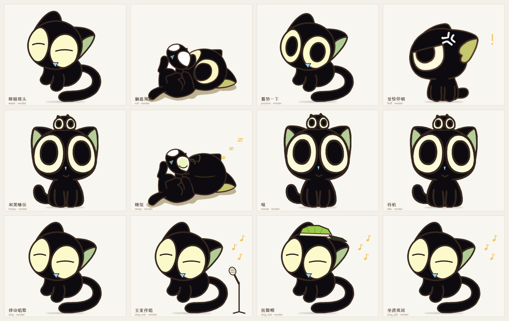

# 桌面大肥鱼 Coach 1.4.0

[](https://github.com/crystalpony/dafeiyu-coach/actions/workflows/ci.yml)
[](https://github.com/crystalpony/dafeiyu-coach/releases/latest)
[](LICENSE)
[](https://github.com/crystalpony/dafeiyu-coach/releases/latest)

> 一只住在 macOS 桌面上的大肥鱼；现在还能换成《罗小黑战记》里的小黑（猫形态）。Agent 在对话里调用她，她就在屏幕上用**指针圈、语言气泡和 15/25 段动画**，一步一步带用户把事情做完；放歌时小黑会跟着律动、换着花样唱；没有任务时，她安静地陪着。
>
> **平台**：macOS 原生桌宠（Swift/AppKit）· Windows 桌面窗口版（Tk + Pillow，透明置顶、动画/气泡/指针）· Windows/macOS/Linux 终端轻量版（Python TUI）· 同一套 skills / CLI / MCP。

**下载**：[最新 Release](https://github.com/crystalpony/dafeiyu-coach/releases) · [1.4.0 macOS](https://github.com/crystalpony/dafeiyu-coach/releases/download/v1.4.0/dafeiyu-coach-1.4.0-macos.zip) · [1.4.0 Windows](https://github.com/crystalpony/dafeiyu-coach/releases/download/v1.4.0/dafeiyu-coach-1.4.0-windows.zip) · [SHA256](https://github.com/crystalpony/dafeiyu-coach/releases/latest/download/SHA256SUMS)

这是 `Desktop/qoder-coach/Coach.swift` 的**独立版**：不再绑定某个固定教程的状态文件，而是通过 **skills / CLI / MCP** 被 Qoder、Codex、Claude Code、dsh 等 Agent 调用。原来的 `Coach.swift`、`state.json` 不动。




> **本轮验证（2026-10-29）**：完整回路 **186/186**；1992 帧解码/哈希与 75 帧重渲染一致；33 项新增单测通过，旧 ghost 和错段清单负例被拒绝。五原稿未改，嘴眼保留原图；有限动作与未实现项见 [当前验收](docs/ACCEPTANCE-1.4.md)。[实机立麦](audit/screenshots/19-xiaohei-mic-live.png)已截图复核；下方 Windows CI 图是历史资料，本轮未在 Windows 真机验收。


## 能做什么

- **指着屏幕教**：主屏任意坐标画脉冲圆环、箭头、虚线牵引和标签；窗口鼠标穿透，不挡操作。
- **一步一步**：`guide` 建任务，气泡显示「第 2/5 步」、标题、正文、提示与进度圆点；`next` 推进，最后一步撒花。
- **随时关掉指导**：菜单栏 / 右键菜单勾选「任务指导（指引模式）」即可关闭；当前任务、指针和指导气泡立刻清空，桌宠回到待机。关闭期间 Agent 的 `guide` / `point` / 三步演示都会被拒绝，重新勾上就恢复；也可以用 `dafeiyu config --guide off|on`。
- **两个形象，手动切换**：菜单「形象」在**大肥鱼**与**小黑**（罗小黑猫形态）之间切换，选择持久化到 `settings.json`；也可以 `dafeiyu character xiaohei`。小黑只使用项目所有者手绘并授权的五张姿态稿，制作眨眼/表情、有限姿态运动、摇尾与道具动画（24fps、300×250、25 段）；嘴像素保留原图，无程序张嘴。
- **15/25 段动画**：大肥鱼 15 段，行为不改；小黑 25 段 / 1992 帧，包括**眯眼摇头、躺着晃晃、蓄势一下、受惊停顿、睡觉、喵、和黑咻玩**，以及**律动唱歌、立麦伴唱、街舞帽、坐直摇尾** 4 种唱歌变体。动作名不代表完整骨骼运动。
- **放歌时唱歌**：读系统 Now Playing（Apple Music / 网易云 / QQ 音乐 / Spotify），播放独立的唱歌动画；歌词按播放时间戳插值逐句推进，不再卡在开场第一句。头顶默认是一条 **280×50 pt** 的紧凑歌词条，只显示歌名和当前句（超长自动省略）。菜单「气泡大小」可直接输入百分比，或手动填宽/高（pt）；桌宠和气泡都带安全边界（小到仍点得到、大到不超过半屏）。没有歌词就诚实显示“跟着哼”。歌词来自 LRCLIB 或本地 LRC，可完全离线。
- **陪伴**：待机小动作、按前台应用说一句（写代码 / 查资料 / 回消息 / 做音乐）、困倦与睡觉；小黑 `yawn` 是“困倦眯眼”，不是张嘴哈欠；会议模式一键安静。
- **趣味互动**：摸头、戳身体、碰尾巴、拖拽、双击（大肥鱼转圈 / 小黑躺着晃晃）、**添一碗米饭**（独立米饭动画：白瓷碗、米饭、筷子、热气，不复用吃 token 的剪辑）、小黑有限动作与喂小鱼、睡觉/叫醒、番茄钟专注、游到鼠标边、感知应用切换。
- **Windows 桌面窗口版**：`dafeiyu gui`，透明无边框置顶、15/25 段动画、气泡、指针、米饭、右键菜单；与 TUI 共用同一核心。小黑切换单帧切画，不交叉淡化；本轮没有真实 Windows 验收。
- **终端轻量版**：`dafeiyu tui`，ASCII 鱼 + 歌词 + 步骤 + 米饭，Windows/macOS 共用同一核心；不依赖 AppKit。
- **体积与验证**：小黑引用帧 25.50 MiB，含 manifest 为 25.69 MiB；双形象运行体 35.29 MiB。真实 daemon 观察 30.031 秒、799 次采样中始终单帧显示（这是播放状态观察，不是 GPU 呈现帧率）。双平台包按 `dist/SHA256SUMS` 和逐帧校验报告验证。
- **好适配**：Qoder / Claude Code / Codex / dsh 四套 skill，三套 `/dafeiyu` 斜杠命令，一个 stdio MCP，外加通用 `AGENTS.md` 片段。

## 两个形象

菜单栏 →「形象」→ 大肥鱼 / 小黑；也可以：

```bash
dafeiyu xiaohei wash         # 也可直接触发小黑动作：wash/roll/pounce/fluff/heixiu/meow/sleep/fish
dafeiyu character            # 查看当前形象与可选列表
dafeiyu character xiaohei    # 切到小黑
dafeiyu character dafeiyu    # 切回大肥鱼
dafeiyu config --character xiaohei   # 等价写法
dafeiyu config --sing-style auto     # auto/sway/mic/hat/tail
dafeiyu config --meow off            # 关掉待机随机喵喵叫
dafeiyu config --meow-sound off      # 只关喵叫音效，保留动作
```

状态里新增 `character` / `displayName` / `characters` / `singStyle` / `singVariant` / `meowEnabled` / `meowSound` 字段。形象选择写进 `~/.dafeiyu/settings.json`，下次启动保持。素材布局：

```text
Runtime/clips/                 # 大肥鱼（上游 MIT 素材）
Runtime/characters/xiaohei/    # 小黑（用户手绘底图 + 程序动画，scripts/build_xiaohei.py 可复现）
```

Windows 桌面窗口版也支持形象：`dafeiyu gui --character xiaohei`；不传参数时读取 `settings.json`。终端版 `dafeiyu tui` 仍是 ASCII 大肥鱼。

小黑的**多视角插图是项目所有者手绘并提供授权**的（`scripts/poses/`，2026-10-28/29）。本轮五张原 PNG 的 SHA 不变，只使用这五稿，不依赖旧 base，也未使用图像生成；恢复源眼原瞳孔，嘴像素保持原图，局部表情后共同仿射，尾巴采用单次预乘 alpha 逆映射。没有使用官方截图、GIF 或未授权第三方图片。角色版权归 MTJJ / 北京寒木春华动画所有；**底图及其派生帧不适用 MIT 代码许可**，仅作为个人同人桌宠在项目内使用，详见 [NOTICE](NOTICE.md)。要删掉小黑，删 `Runtime/characters/xiaohei`（以及安装目录的同名目录）即可，大肥鱼不受影响。

## 小黑互动

菜单栏 →「互动与专注」→「小黑互动」：

- 眯眼摇头、躺着晃晃、蓄势一下、受惊停顿、和黑咻玩、喵一声 / 喵两声、喂条小鱼、睡觉 / 叫醒
- 动作 ID 保持兼容：`wash=眯眼摇头`、`roll=躺着晃晃`、`pounce=蓄势一下`、`fluff=受惊停顿`、`heixiu=和黑咻玩`、`yawn=困倦眯眼`
- `meow` 仅吸气/眨眼，不张嘴；保留既有 CC0 0.85s 猫叫音效（可静音，macOS 用 NSSound，Windows GUI 用 winsound）
- 双击小黑 = 躺着晃晃；摸头/戳身体/碰尾巴仍有反馈
- 待机时随机眯眼摇头、喵、和黑咻玩；「小黑设置」可单独关掉随机喵和喵叫音效，手动「喵一声 / 喵两声」仍可用
- 闲置 10 分钟自动进入睡觉循环，点一下叫醒；本轮 `sleep` 修为闭主眼，而非误闭头顶黑咻的眼睛

## 小黑日常

菜单栏 →「小黑日常」：

- **小动作**：伸懒腰、困倦眯眼、摇尾巴；**玩耍**：蓄势一下、受惊停顿、和黑咻玩
- **吃什么**：小鱼干、米饭、月饼、粽子
- **时节**：共 15 个——春节、元宵、端午、中秋、重阳、万圣、圣诞、新年，加上落叶、雪人、烟花、腊八粥、年糕、青团、福字。选中后桌宠旁出现对应的平涂小道具（灯笼、粽子、月饼、南瓜、礼物、红包、菊花、落叶、雪人、烟花、粥、年糕、青团、福字），不烘焙进角色帧，6.5 秒后自动收起
- **移动**：屏幕中央 / 左上 / 右下 / 鼠标旁
- **说句话…**：自定义气泡文字；**碎碎念**：随机台词；**工作状态**：前台 App、专注、唱歌、米饭和喵音效状态

对标截图的历史逐项对照见 [docs/PRODUCT_UPGRADE.md](docs/PRODUCT_UPGRADE.md) 的「3.1 与截图逐项对照」；本轮能力与验收以 [当前验收](docs/ACCEPTANCE-1.4.md) 为准。

**黑咻**只保留手绘原图已有形象，不再从尾尖冒出新分身。“和黑咻玩”不表示已实现尾巴分裂。

本轮生成器重写为582 行，删除旧 base 依赖及同名 `@clip` 覆盖，仅有 25 个唯一注册。无附加前臂/后腿，保留原 QA 守卫；固定接地线，关闭小黑 View 二次 bob/旋转，避免对烘焙帧重复施加运动。**未实现**：五稿没有真实转身、跳扑、全翻滚、尾巴卷握的中间姿态，在不补稿、不加肢体的条件下不能做好这些动作；本轮是移除伪造效果，不是完整骨骼引擎。小黑切换是单帧切画，不是转身或无缝淡化。

已复核证据：[嘴眼对照](audit/screenshots/16-xiaohei-face-evidence.png)、[摆尾轮廓](audit/screenshots/17-xiaohei-tail-evidence.png)、[睡姿实机](audit/screenshots/18-xiaohei-sleep-live.png)、[立麦实机](audit/screenshots/19-xiaohei-mic-live.png)、[帽子实机](audit/screenshots/20-xiaohei-hat-live.png)。前两张来自真实 WebP 解码，后三张由 audit 对运行中的 AppKit daemon 截图。

## 唱歌舞台

小黑放歌时可选 4 种变体，均不叠加程序嘴：

| 变体 | 表现 |
| --- | --- |
| `sing` | 接地的侧视身体律动；独立摆尾在 `sing_tail` |
| `sing_mic` | 立麦伴唱；保留 ID 兼容，不用尾巴分叉或卷握麦克风 |
| `sing_hat` | 街舞帽道具 + 身体律动 |
| `sing_tail` | 坐直摇尾；不等于真实站立 |

- 菜单「唱歌」→「唱歌花样」可选**自动 / 只律动 / 立麦伴唱 / 街舞帽 / 坐直摇尾**；「试唱一段（20 秒）」不依赖音乐监听，方便直接预览。
- 自动模式每 8–16 秒偶发切一次，同曲不连续重复同一种特别动作；小黑所有播放切换均单帧切画，不再交叉淡化。
- 可用 `dafeiyu config --sing-style mic` 固定，或用 `--sing-style auto` 交给自动编排。
- 变体只使用现有五稿及道具，不新增手臂或腿。

产品升级矩阵与后续路线见 [docs/PRODUCT_UPGRADE.md](docs/PRODUCT_UPGRADE.md)；历史效果描述以 [docs/ACCEPTANCE-1.4.md](docs/ACCEPTANCE-1.4.md) 的当前修正为准。


## 音乐与唱歌

支持的播放器：Apple Music、网易云音乐、QQ 音乐、Spotify 等**向系统 Now Playing 报告状态**的 App。

- macOS 用 BSD 许可的 MediaRemote 适配器读取系统 Now Playing，不需要辅助功能/录屏权限（Apple Music、网易云已真机验证）。
- Windows 用系统 SMTC（`media_smtc.ps1`），覆盖网易云/QQ 音乐/Apple Music/Spotify。
- 歌词源：LRCLIB →（可选）网易云歌词兜底 → 本地 LRC。只发送 **歌名 / 歌手 / 时长**；不读音频、不录音、不上传本地文件。
- 不想用网易云兜底：`dafeiyu music provider lrclib`（`auto` 为默认，`netease` 可强制）。
- 没有网络或没有歌词时：用 `~/.dafeiyu/lyrics/local/` 的 `.lrc`；再没有就显示“跟着哼”。
- 只在**空闲、非安静模式、会议 App 不在前台**时唱歌；一有任务就让位给指导气泡。

```bash
dafeiyu music on                 # 启动歌词监听（安装脚本默认会启动）
dafeiyu music status             # 当前歌曲 + 监听状态
dafeiyu music now                # 只输出当前歌曲 JSON
dafeiyu music off                # 停止监听并收起歌词
dafeiyu music test --line "海风轻轻吹过"   # 不联网，测试唱歌
dafeiyu music import-lrc 晴天.lrc --title 晴天 --artist 周杰伦
dafeiyu music offset 0.4         # 歌词整体偏移
dafeiyu music provider lrclib    # 只使用 LRCLIB，不用网易云兜底
```

> 唱歌是**视觉卡拉 OK**：独立唱歌动画 + 头顶紧凑歌词条 + 音符；不会播放 TTS/音频，避免盖住你的音乐。

## 安装

### macOS 原生版

要求：macOS 13+、Xcode Command Line Tools（`swiftc`）、Python 3.9+（系统自带或 CLT 提供）。二进制为 universal（arm64 + x86_64）。

```bash
cd dafeiyu-coach
scripts/install.sh            # 编译（如需要）+ 安装 + 四套 skills + 启动
scripts/install.sh --with-mcp # 额外写 Qoder/Claude/Codex 的 MCP 配置（自动备份）
scripts/install.sh --no-music # 只装桌宠，不启动音乐监听
```

### Windows 桌面窗口版 / 终端版

要求：Windows 10 1803+、Python 3.9+、PowerShell 5.1+。不需要编译，不需要 AppKit。

```powershell
powershell -ExecutionPolicy Bypass -File scripts\install.ps1
dafeiyu.cmd tui          # 或把安装目录加进 PATH 后： dafeiyu tui
```

Windows 同时提供：
- **桌面窗口版**：`dafeiyu-gui.cmd` 或 `dafeiyu gui`（Python 3.9+ / Pillow；安装脚本会装 Pillow、复制 clips）。透明置顶、拖拽、动画/气泡/指针/歌词/米饭；由 Win32 透明色 + 点击穿透实现。
- **终端轻量版**：`dafeiyu tui`（ASCII 宠物 + 歌词 + 米饭 + 步骤），无 Pillow 也能跑。

> Windows 桌面版是 Tk/Pillow 实现，视觉与 macOS AppKit 版不完全一致；CI 会跑窗口冒烟并上传截图，但不等同于真实 Windows 桌面人工验收。

安装位置：

| 内容 | 路径（macOS） |
| --- | --- |
| 命令 | `~/.local/bin/dafeiyu` |
| 守护进程 | `~/.local/bin/dafeiyu-daemon` |
| MCP | `~/.local/bin/dafeiyu_mcp.py` |
| 动画 / 音乐 / 设置 / 会话 | `~/.dafeiyu/` |
| 终端版 | `dafeiyu tui`（同一 `~/.dafeiyu`） |
| Skills | `~/.qoder/skills/dafeiyu-coach/`、`~/.claude/skills/…`、`~/.codex/skills/…`、`~/.dsh/skills/…` |
| 斜杠命令 | `~/.qoder/commands/dafeiyu.md`、`~/.claude/commands/…`、`~/.codex/prompts/…` |

可选：

```bash
scripts/install.sh --with-mcp   # 写入 Qoder/Claude/Codex 的 MCP 配置（自动备份）
scripts/install.sh --build      # 强制重编译
scripts/install.sh --no-start   # 只安装，不启动
```

没把 `~/.local/bin` 加进 PATH 也能用绝对路径调用。

### 直接跑起来

```bash
dafeiyu doctor                  # 自检（进程/素材/音乐/终端版/skills）
dafeiyu hello --agent qoder     # 打招呼
dafeiyu demo                    # 三步演示（指针 + 气泡 + 撒花）
dafeiyu tui                     # 终端轻量版（可同时作为 macOS 原生版的显示器）
dafeiyu stage on                # 演示舞台：盖住其它应用，方便截图/录屏（off 恢复）
```

## 在 Agent 里怎么用

### 1. Skills（推荐）

安装脚本已经把同一份 `SKILL.md` 放进四个 Agent 的技能目录。安装后 Qoder 会立即识别出 `dafeiyu-coach` 技能和 `/dafeiyu` 命令（本次安装已验证），其他客户端重启会话后生效。直接说：

> 让大肥鱼一步一步教我在 GarageBand 里做一段 EP。

Agent 会按 skill 的流程调用：

```bash
dafeiyu hello --agent qoder
dafeiyu guide --file guide.json
dafeiyu next --say "很好，继续。"
dafeiyu finish
dafeiyu bye
```

`guide.json`：

```json
{
  "title": "在 GarageBand 里做一段 EP",
  "steps": [
    {"text": "先点左侧的 Electric Piano 轨道。", "x": 640, "y": 300,
     "label": "点这个轨道", "hint": "没有 EP 轨就按 ⌘N 新建"},
    {"text": "按 ⌘T 打开乐器，选 Electric Piano。"},
    {"text": "用铅笔在第 1 小节点 4 个音：C#4 / E4 / G#4 / B4。",
     "x": 820, "y": 520, "label": "从这里开始画"},
    {"text": "按空格试听，确认味道。"}
  ]
}
```

### 2. `/dafeiyu` 斜杠命令

在 Qoder / Claude Code / Codex 里输入 `/dafeiyu`，让当前 Agent 立刻进入指导流程。

### 3. MCP

```json
{
  "mcpServers": {
    "dafeiyu": {"command": "dafeiyu", "args": ["mcp"]}
  }
}
```

工具：`dafeiyu_begin`、`dafeiyu_guide`、`dafeiyu_next`、`dafeiyu_point`、`dafeiyu_say`、`dafeiyu_play`、`dafeiyu_status`、`dafeiyu_finish`、`dafeiyu_end`、`dafeiyu_feed`。
Codex 的 TOML、Qoder/Claude 的 JSON 片段在 [`adapters/mcp/`](adapters/mcp/)。

### 4. 没有 skills 的 Agent

把 [`adapters/AGENTS.md`](adapters/AGENTS.md) 贴进项目 `AGENTS.md`（或 Cursor Rules）即可。dsh 的注意事项见 [`adapters/dsh.md`](adapters/dsh.md)：dsh 自带的 `dsh-dafeiyu` 原生桌宠和本项目可以二选一，避免两只鱼同时出现。

## CLI 速查

| 命令 | 作用 |
| --- | --- |
| `dafeiyu hello --agent qoder` | 打招呼、声明 Agent 已连接 |
| `dafeiyu guide --file g.json` / `--step "…"` | 开始分步任务（`--unit pt/px/norm`） |
| `dafeiyu next [--say "…"]` / `prev` / `finish` / `cancel` | 推进 / 回退 / 完成 / 取消 |
| `dafeiyu point --x 640 --y 300 --label "…"` | 只画指针（`--hold` 秒） |
| `dafeiyu say "…" --step 2/5 --tone success` | 只说话，可带徽章/情绪/动画 |
| `dafeiyu play success` | 播放动画 |
| `dafeiyu mood thinking\|focus\|happy\|sleepy` | 情绪 |
| `dafeiyu feed` / `dance` / `come` / `quip` | 添米饭 / 跳舞 / 游到鼠标边 / 随口一句 |
| `dafeiyu music on\|off\|status\|now\|test` | 歌词监听与唱歌 |
| `dafeiyu music import-lrc …` / `offset 0.4` | 本地歌词 / 偏移 |
| `dafeiyu focus --minutes 25` / `--cancel` | 番茄钟 |
| `dafeiyu quiet on --minutes 60` | 会议模式（到点自动解除） |
| `dafeiyu gui` | Windows/macOS 桌面窗口版 |
| `dafeiyu tui` | 终端轻量版（Windows/macOS） |
| `dafeiyu stage on\|off` | 演示舞台：盖住其它应用，截屏/录屏用 |
| `dafeiyu hide` / `show` / `quiet on\|off` / `scale 1.2` | 显隐 / 安静 / 大小 |
| `dafeiyu config --bubble-scale 0.8` | 气泡百分比（40% 起；会退出手动宽高） |
| `dafeiyu config --bubble-width 320 --bubble-height 56` | 气泡手动宽×高（pt，最大半屏；`--bubble-auto` 复原） |
| `dafeiyu config --guide off` | 关闭任务指导：清空当前任务与指针并回空闲；`--guide on` 恢复 |
| `dafeiyu status [--json]` / `info` / `doctor` | 状态 / 屏幕 / 自检 |
| `dafeiyu start` / `stop` | 启动 / 退出守护进程 |
| `dafeiyu demo` | 三步演示 |
| `dafeiyu mcp` | 以 stdio MCP 运行 |

所有命令都支持 `--json`（放在子命令前后均可），便于 Agent 解析。

## 坐标

- 默认 `pt`：**主屏左上角**为原点，x 向右、y 向下；多屏以主屏左上角为基准。
- 截图里量的是像素 → `--unit px`，按主屏 Retina scale 自动换算。
- `--unit norm`：0~1 归一化。
- `dafeiyu info` 可看主屏尺寸与 scale；`status --json` 里有 `mainScale`、`screens`、`pet`、`bubble`、`clip`、`frame`。

## 动画

| clip | 时长 | 用途 |
| --- | --- | --- |
| idle | 10.1 s 循环 | 待机 |
| thinking | 10.1 s 循环 | 思考 / 等确认 |
| working | 10.1 s 循环 | 工作 / 指针引导 |
| success | 5.0 s | 完成（撒花） |
| error | 3.0 s | 出错 |
| pat | 4.0 s | 打招呼 / 摸头 |
| poke / tail | 3.0 s | 被戳 / 碰尾巴 |
| eat | 4.0 s | 投喂 |
| stretch / yawn | 4.0 s | 伸懒腰 / 困 |
| drag / drop | 5.0 s / 1.5 s | 拖拽 / 落地 |

上表为大肥鱼：300×250 WebP、12 fps，按需解码，LRU 28 帧；落地（drop）为 24 fps，其余为 12 fps。小黑为 25 段 / 1992 帧 / 24fps；Python 小黑 GUI 使用 16ms 调度而非 70ms，调度间隔不等于实测帧率。

**过渡**：动画有优先级（拖动 > 出错 > 成功 > 指导 > 说话 > 待机），同一剪辑不重复从头播放。大肥鱼保留 120–180ms 双层交叉淡化及原行为；小黑所有播放切换单帧切画，不 crossfade、不宣称转身。气泡内容淡入与角色帧切换是两回事。见 [架构](docs/ARCHITECTURE.md)。

## 架构

```
Agent (Qoder / Codex / Claude / dsh / MCP 客户端)
   │  skill / /dafeiyu / MCP tools / CLI
   ▼
dafeiyu (Python CLI)  ── UNIX 0600 ──►  dafeiyu-daemon (Swift/AppKit, macOS)
   │                              └──►  dafeiyu tui (Python, 本机 TCP+token, Windows/macOS)
   │
   └─ dafeiyu_music.py ── MediaRemote(macOS) / SMTC(Windows) ──► LRCLIB / 本地 LRC
                                      │
                                      └─ lyric 命令 ──► 歌词气泡 + 唱歌

dafeiyu-daemon (Swift + AppKit, universal 单二进制)
   ├─ PetView         15/25 段动画、拖拽、摸头/戳/尾巴、爱心/彩纸、zzz
   ├─ BubbleView      标题 / 正文 / 步骤徽章 / 进度点 / 自动收起
   ├─ PointerView     每屏一层，脉冲圈 + 箭头 + 虚线 + 标签
   ├─ AppController   任务状态机、设置/会话持久化、菜单栏
   └─ Companion       待机小动作、应用感知、游到鼠标、睡觉
```

- **无网络**：只使用 `AF_UNIX`；不读屏、不申请辅助功能、不合成点击、不读剪贴板。
- **协议**：一行一个 JSON；`{"cmd":"...", ...}` → `{"ok":true,...}`。
- **状态**：`~/.dafeiyu/settings.json`（位置/大小/安静/指引模式）、`session.json`（未完成任务可跨重启恢复；指引模式关闭时不会恢复）。
- 细节见 [docs/ARCHITECTURE.md](docs/ARCHITECTURE.md)。

## 性能与体积（历史大肥鱼基线，非本轮结果）

下表保留历史大肥鱼本机数据，不代表当前小黑；本轮实测见 [验收清单](docs/ACCEPTANCE-1.4.md) 与 `audit/last-report.json`。

| 项目 | 历史实测 |
| --- | --- |
| 二进制 | 1.2 MB（universal arm64 + x86_64） |
| 动画素材 | 7.48 MB / 15 组 / 890 帧 |
| 音乐适配器 | 669 KB（MediaRemote framework + Perl 脚本） |
| 安装后运行体 | ≈ 9.3 MB |
| 冷启动 | 0.30 s |
| 待机 CPU / RSS | 3.6% / 71 MB |
| 动画 + 指针 CPU / RSS | 7.4% / 80 MB |

优化手段：24 Hz 主时钟 + 12 fps 动画、仅在换帧时重绘、窗口被遮挡/隐藏时暂停、LRU 帧缓存、指针层仅在激活时置顶、待机操作限频、10 分钟无交互后睡觉。

## 目录

```
dafeiyu-coach/
├── Sources/               Swift 守护进程（11 个文件）
├── bin/dafeiyu            CLI（Python，无第三方依赖）
├── bin/dafeiyu_mcp.py     stdio MCP
├── Runtime/clips/         压缩后的动画素材 + manifest（MIT）
├── Runtime/music/         BSD MediaRemote 适配器 + Windows SMTC 脚本
├── skills/dafeiyu-coach/  唯一一份 SKILL.md，安装到各 Agent
├── adapters/              各 Agent 配置、/dafeiyu 命令、AGENTS.md、dsh 说明
├── scripts/               build / install / uninstall / build_assets
├── .github/workflows/     macOS + Windows CI
├── audit/                 audit.py + 截图 + last-report.json
└── docs/                  架构、审计、变更记录
```

## 卸载

```bash
scripts/uninstall.sh            # 移除二进制、skills、斜杠命令，保留设置
scripts/uninstall.sh --purge    # 连 ~/.dafeiyu 一起删
```

MCP 配置（如果加过）需要手动从 Qoder/Claude/Codex 配置里移除 `dafeiyu`。

## 审计

```bash
python3 audit/audit.py            # 全量（安装到临时 HOME，不碰真实配置）
python3 audit/audit.py --no-visual
```

审计覆盖编译、体积、单元、安装/卸载、CLI、音乐/歌词、气泡/指针、米饭/专注、播放器切换、终端 TCP、截图、MCP、性能、隐私及文档。本轮完整重建 / QA / audit 于 2026-10-29 10:54:47 完成，**186/186**；原断言保留，新增检查与未实现边界见 [当前验收](docs/ACCEPTANCE-1.4.md)。

小黑增强 QA 保留原守卫，解码全部 1992 帧，核验五稿/生成器/每帧 SHA，重新生成 75 帧逐 byte 比较并检查全循环周期；manifest 记录这些 SHA，prune 使用完整相对路径清理 `idle 2/` 与同名残留。已实跑几何 14 项、播放器 8 项全过，旧 ghost 负例按预期失败，不等于全量审计已通过。Windows 单测、macOS 实机后续补验；本轮没有真实 Windows 验收。历史材料见 [审计](docs/AUDIT.md) 与 [迭代记录](docs/ITERATIONS.md)。

## 许可与致谢

代码 MIT。角色动画素材来自 [PC2005-cloud/dsh-pet](https://github.com/PC2005-cloud/dsh-pet)（MIT），经 [QCYTSN/dsh-dafeiyu](https://github.com/QCYTSN/dsh-dafeiyu) 重新打包；本项目只取用其中的 idle/thinking/working/success/error/pat/poke/tail/eat/stretch/yawn/drag/drop，降采样重编码以控制体积。

设计上参考了 dsh-dafeiyu 的交互方式（拖拽/摸头/待机小动作）、[openpets](https://github.com/alterhq/openpets) 的 CLI + MCP 分工，以及 [Neco](https://github.com/winebarrel/Neco) 的“追鼠标”趣味。macOS 音乐检测使用 [ungive/mediaremote-adapter](https://github.com/ungive/mediaremote-adapter)（BSD-3-Clause）；歌词来自 [LRCLIB](https://lrclib.net/)。完整声明见 [NOTICE.md](NOTICE.md)。

## 平台支持矩阵

| 能力 | macOS 原生版 | Windows 终端版 | macOS/Linux 终端版 |
| --- | --- | --- | --- |
| 指针圈 / 悬浮气泡 / 15/25 段动画 | ✅ | 文本气泡 + 步骤（无指针） | 文本气泡 + 步骤 |
| Agent skills / CLI / MCP | ✅ | ✅ | ✅ |
| 音乐检测 / 歌词 / 唱歌 | ✅ Apple Music / 网易云 / QQ（系统 Now Playing） | ✅ 系统 SMTC | 取决于系统 |
| 米饭 / 番茄钟 / 会议模式 | ✅ | ✅（会议模式用 `quiet`） | ✅ |
| 桌面 GUI | ✅ AppKit | ✅ Tk/Pillow（CI 冒烟；视觉未真机人工验收） | ❌ |
