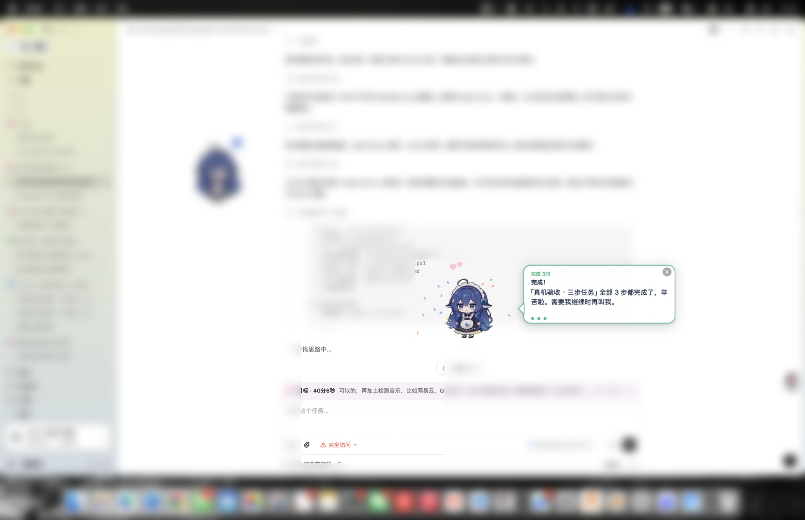
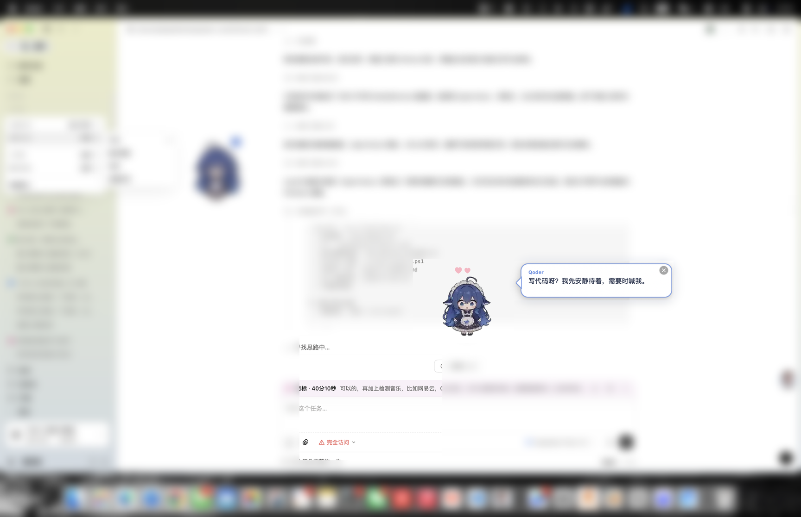

# 审计报告 · 桌面大肥鱼 Coach 1.1.0

> 最近运行：2026-10-27（见 `audit/last-report.json`）
> 环境：macOS 15.7.3 · Apple M1 Max · arm64 · 主屏 1728×1117 pt @2x · Xcode CLT Swift 6.0
> 方式：`python3 audit/audit.py`。默认在**临时 HOME** 中安装、运行、截图与卸载，不修改真实的 `~/.dafeiyu` 和 Agent 配置。

## 结论

**123/123 通过。**

| 分组 | 通过 |
| --- | --- |
| 构建与静态 | 8/8 |
| 体积 | 5/5 |
| 安装与适配 | 21/21 |
| 端到端 | 28/28 |
| 音乐 / 歌词 | 4/4 |
| 互动（米饭 / 番茄钟 / 会议） | 3/3 |
| 过渡 | 1/1 |
| 终端轻量版 | 5/5 |
| MCP | 10/10 |
| 性能 | 6/6 |
| 隐私 | 4/4 |
| 文档 | 14/14 |
| 可视化 | 11/11 |
| 卸载 | 3/3 |
| **总计** | **123/123** |

机器可读结果：`audit/last-report.json`；三轮迭代见 [ITERATIONS](ITERATIONS.md)。

## 需求 → 证据

| 需求 | 实现 | 审计证据 |
| --- | --- | --- |
| 独立版，不再针对单一教程 | 守护进程 + UNIX socket；任务/设置/会话在 `~/.dafeiyu`；旧 `Coach.swift` 不动 | `e2e` 全组；重启恢复 |
| Agent 对话 / skills 调用 | Qoder / Claude / Codex / dsh 四套 skill、三套 `/dafeiyu`、12 个 MCP 工具 | `install`、`mcp` |
| 指针 + 气泡 | 每屏 overlay；标题/正文/下一句/徽章/进度点 | 截图 01；px 换算；music 截图 04 |
| 多种动画 | 13 段；优先级 + 120–180ms 交叉淡化 | 13 段 play；`blend<1`；截图 02 |
| 一步一步 | guide → next → finish；跨重启恢复 | 三步任务、完成态 |
| 空闲陪伴 | 待机小动作、应用感知、游到鼠标、睡觉 | `quip`；截图 03 |
| 音乐检测 + 歌词 + 唱歌 | macOS BSD MediaRemote / Windows SMTC；LRCLIB/本地 LRC；视觉卡拉 OK | 真机网易云/Apple Music；本地 LRC；截图 04 |
| 互动（米饭/番茄钟/会议/减少动态） | 米饭碗+计数、番茄钟、会议模式、减少动态 | `interaction`；截图 05 |
| 储存/性能 | 1.1 MB universal + 6.90 MB 素材 + 196 KB 适配器 | `size`、`perf` |
| 各种 Agent 适配方便 | skills + 命令 + MCP + AGENTS.md + dsh 说明 | `install`、`mcp` |
| GitHub 复用并优化 | MIT 动画素材；BSD MediaRemote；LRCLIB；SMTC 原创 | `NOTICE`；`Runtime/music` |
| 趣味玩法 | 摸头/戳/尾巴/拖拽/双击/米饭/跳舞/游到鼠标/应用反应 | e2e、截图 |
| Windows + macOS | macOS 原生 GUI；Windows/macOS/Linux 终端版（TCP+token、SMTC） | `tui` 组；Windows CI |
| 通过所有审计 | 本文件 + 机器可读报告 | 123/123 |

## 关键数据

| 指标 | 实测 | 阈值 |
| --- | --- | --- |
| 单二进制（universal） | 1.1 MB | < 2 MB |
| 动画素材 | 6.90 MB / 13 组 / 820 帧 | < 8 MB |
| 音乐适配器 | 196 KB | < 1 MB |
| 运行体总计 | ≈ 8.2 MB | < 10 MB |
| 冷启动 | 0.30 s | < 4 s |
| 待机 CPU | 3.5% | < 6% |
| 待机 RSS | 70 MB | < 140 MB |
| 动画 + 指针 CPU | 6.9% | < 14% |
| 动画 + 指针 RSS | 83 MB | < 160 MB |

> 性能受屏幕尺寸、Retina、系统负载影响；此为 M1 Max 采样，不是上限承诺。

## 截图证据

背景已高斯模糊，只保留桌宠、气泡与指针区域，避免暴露桌面内容。

### 1. 指针 + 气泡 + 步骤


### 2. 完成庆祝



### 3. 待机陪伴



### 4. 歌词 + 唱歌


### 5. 米饭 + 饭碗


### 6. 终端轻量版

```text
   /\ 
   ___/  \___
  <  o    o  >   ♪
   \__/\__/
      \/
      ♪   ♫

+----------------------------------------------------------------------+
| 桌面大肥鱼 · 测试                                                    |
| ♪ 1/2                                                                |
| 海风轻轻吹过，我在桌面上陪你。                                       |
+----------------------------------------------------------------------+
  ♪ 桌面大肥鱼 - 测试
    下一句也唱给你听。
  米饭 1 碗 · [f]添饭 [p]摸摸 [space]下一步 [q]退出
```

## 自动化检查覆盖（123 项）

1. **构建与静态（8）**：`swiftc -warnings-as-errors`、构建产物、Python/Shell 语法、内置自测（含会议 App 判断）、素材清单、单文件行数、manifest 许可。
2. **体积（5）**：二进制 / 素材 / 音乐适配器 / 运行体 / 源码。
3. **安装与适配（21）**：安装、CLI/daemon/MCP/音乐/终端/素材、四套 skill、三套命令、MCP 配置、doctor、幂等且保留自定义配置。
4. **端到端（28）**：hello、guide（px）、next/prev/finish/cancel、持久化、自动收起、Unicode/长文案、point、13 段 play、趣味互动、hide/show、quiet、scale、错误参数、帧动画、stop、僵尸 socket、崩溃重启、会话恢复、socket 0600。
5. **音乐/歌词（4）**：music test 唱歌、歌词气泡、music off、本地 LRC + watcher 当前行。
6. **互动（3）**：米饭计数、番茄钟到点、会议模式到点解除。
7. **过渡（1）**：切换时 `blend<1`。
8. **终端版（5）**：启动核心、CLI 经 TCP 读状态、guide、next/feed/status、stop 清理端口。
9. **MCP（10）**：initialize、12 工具、schema、begin/guide/next/finish/music/focus、完成态。
10. **性能（6）**：启动、待机 CPU/RSS、动画+指针 CPU/RSS、记录。
11. **隐私（4）**：无网络/读屏/合成点击 API（原生）、只监听本机、歌词只访问 LRCLIB、无 TODO。
12. **文档（14）**：README、LICENSE、NOTICE、CHANGELOG、ARCHITECTURE、AUDIT、ITERATIONS、SOCIAL、CI、music README、Windows 安装、AGENTS、dsh、素材署名。
13. **可视化（11）**：5 张截图 + 终端渲染 + 非空检查。
14. **卸载（3）**：移除二进制/skills/music/tui、保留设置、`--purge`。

## 已知限制

- **Windows 目前是终端版**，不是原生桌面 GUI。原生桌面 GUI 仍需 Tauri/WinUI 另做；Windows 的 SMTC 仅做脚本解析与 TUI 核心 CI，尚未在真实 Windows 桌面上播放网易云/QQ 音乐验收。
- **QQ 音乐**未实际播放（本机未登录/无曲目）；适配器走系统 Now Playing，和网易云/Apple Music 同一条通道；QQ 音乐用户需自行播放验证。
- **单屏实测**：多屏逻辑已实现，但没有第二块屏证据。
- **交互点击未自动化**：审计不申请辅助功能，不合成鼠标事件；摸头/戳/尾巴/拖拽/双击/关闭按钮/菜单为代码路径 + 手工验收项。
- **全屏 Space 未专门验收**：窗口使用 `.canJoinAllSpaces + .stationary + .fullScreenAuxiliary`。
- **Windows CI**：GitHub Actions 会跑 Python/TUI/TCP/SMTC 语法；真实 Windows GUI 不在本轮。
- **歌词覆盖**：LRCLIB 不是每首歌都有；本地 LRC/跟哼兜底；歌词版权归权利人，不再分发文本。
- **性能数字不是承诺**：RSS 含 AppKit/解码缓存，长时间运行会波动。

## 复现

```bash
cd DesktopFishCoach
python3 audit/audit.py               # 全量（含截图，临时 HOME）
python3 audit/audit.py --no-visual   # 无截图
python3 audit/audit.py --keep-temp   # 保留临时目录
```

手工验收：

```bash
scripts/install.sh
dafeiyu music on
dafeiyu demo
dafeiyu tui
# 播放网易云/Apple Music；观察歌词气泡；暂停应收起
# 拖动鱼、点头部/身体/尾巴、双击、右键菜单、添饭、番茄钟、会议模式
```
